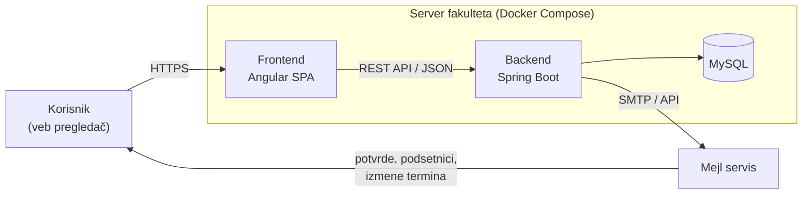

# ConsultMe

**Portal za zakazivanje konsultacija sa nastavnicima**

Studentski projekat iz predmeta *Upravljanje softverskim projektom*.

ConsultMe je veb aplikacija u kojoj nastavnici objavljuju termine konsultacija, studenti ih rezervišu i otkazuju, a sistem automatski šalje potvrde, podsetnike i obaveštenja o izmenama i vodi evidenciju održanih konsultacija.

---

## Problem

Konsultacije se danas dogovaraju mejlom ili prema terminima sa sajta katedre i oglasne table. Termini se često menjaju, a informacija o promeni ne stiže pouzdano do svih studenata. Nastavnici gube vreme na prepisku, studenti dolaze uzalud, a evidencija o konsultacijama ne postoji.

## Rešenje

| | Danas | Sa ConsultMe |
|---|---|---|
| **Zakazivanje** | Mejl prepiska ili dolazak bez najave | Rezervacija slobodnog termina u nekoliko klikova |
| **Promena termina** | Sajt katedre, oglasna tabla, pojedinačni mejlovi | Automatsko obaveštenje svim prijavljenim studentima |
| **Pre termina** | Neizvesno da li je nastavnik u kabinetu | Potvrda i podsetnici 24 h, 12 h i 2 h pre termina |
| **Evidencija** | Ne postoji | Evidencija dolazaka i statistika opterećenja |

## Funkcionalnosti

### Faza 1 – MVP

- Prijava preko fakultetskog naloga, sa ulogama **student**, **nastavnik** i **administrator**
- Nastavnik definiše termine (jednokratne i ponavljajuće), kapacitet i mesto održavanja
- Student pretražuje termine po nastavniku i predmetu, rezerviše i otkazuje (najkasnije 2 h pre termina)
- Automatske mejl notifikacije: potvrda, podsetnici i obaveštenje o izmeni ili otkazivanju
- Responzivan prikaz za računar, tablet i telefon

### Faza 2 – Proširenje

- Evidencija održanih konsultacija (dolazak / nedolazak)
- Statistika opterećenja po nastavniku, predmetu i periodu, sa izvozom u CSV
- Administratorski deo za upravljanje katedrama, predmetima i korisnicima
- Pravila za period pred ispitne rokove (npr. ograničenje broja aktivnih rezervacija)

### Van okvira projekta

Mobilna aplikacija, video konsultacije, integracija sa studentskim informacionim sistemom, SMS obaveštenja.

## Tehnologije

| Sloj | Tehnologija |
|---|---|
| Frontend | Angular (SPA, responzivan prikaz) |
| Backend | Java, Spring Boot (REST API, Spring Security) |
| Baza podataka | MySQL |
| Isporuka | Docker, Docker Compose |
| Verzionisanje | Git, GitHub |
| Praćenje zadataka | GitHub Issues, GitHub Projects |
| Notifikacije | Transakcioni mejl servis |

## Arhitektura



- **Frontend** je jednostranična aplikacija koja sa backendom komunicira isključivo preko REST API-ja.
- **Backend** sadrži poslovnu logiku (pravila rezervacije i otkazivanja, kapacitet termina), autentifikaciju i autorizaciju po ulogama i slanje notifikacija.
- **Baza** čuva korisnike, predmete, termine i rezervacije.
- Sve komponente rade u **Docker kontejnerima**, pa je okruženje isto u razvoju, testiranju i produkciji.

### Planirani model podataka

| Entitet | Opis |
|---|---|
| `Korisnik` | Student, nastavnik ili administrator |
| `Predmet` | Predmet i katedra kojoj pripada |
| `Termin` | Vreme, trajanje, mesto i kapacitet konsultacija jednog nastavnika |
| `Rezervacija` | Veza studenta i termina, sa temom konsultacija i statusom dolaska |

## Struktura repozitorijuma

```
USP_Projekat/
├── docs/                  # projektna dokumentacija (PDF)
├── frontend/              # Angular aplikacija            (u izradi)
├── backend/               # Spring Boot aplikacija        (u izradi)
├── docker-compose.yml     # pokretanje celog sistema      (u izradi)
└── README.md
```

## Pokretanje

> Uputstvo će biti dopunjeno kada se dodaju `frontend/`, `backend/` i `docker-compose.yml`.

Planirano pokretanje celog sistema jednom komandom:

```bash
docker compose up --build
```

## Dokumentacija

| Dokument | Opis |
|---|---|
| [Definicija projekta](docs/ConsultMe_Definicija_projekta.pdf) | Project Charter: ciljevi, opseg, rokovi, budžet, rizici, organizacija |
| [Studija izvodljivosti](docs/ConsultMe_Studija_izvodljivosti.pdf) | Feasibility Study: finansijska, tehnička, organizaciona, operativna, pravna i kulturološka izvodljivost |

### Verzije dokumentacije

| Tag | Opis |
|---|---|
| `v0.1` | Prva verzija Definicije projekta |
| `v1.2` | Dopunjena Definicija projekta |
| `v2.0` | Definicija projekta v2.0 |
| `v2.0-potpisano` | Definicija projekta i Studija izvodljivosti v2.0, potpisane od strane tima |

## Način rada

- Svaka funkcionalnost razvija se na posebnoj grani, napravljenoj od ažurnog `main`-a:
  - `feature/...` za nove funkcionalnosti
  - `fix/...` za ispravke
  - `docs/...` za dokumentaciju
- U `main` se ulazi isključivo preko **Pull Request-a**, posle pregleda drugog člana tima.
- Grane se ne brišu nakon spajanja, da bi ostao trag rada.
- Poruke commit-a prate oblik `tip: opis`, npr. `feat: rezervacija termina`, `fix: provera kapaciteta`, `docs: ažuriran README`.
- Zadaci se vode kroz GitHub Issues i prate na kanban tabli u GitHub Projects.

## Tim

| Ime i prezime | Uloga |
|---|---|
| Boris Radosavljević | Menadžer projekta |
| Strahinja Stamenković | Backend |
| Uroš Novosel | Frontend |
